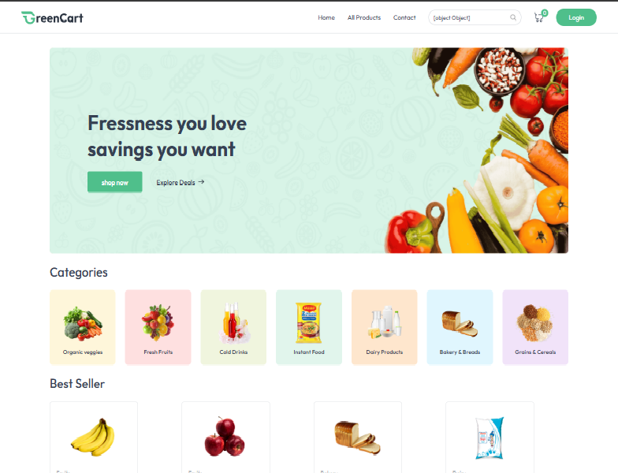
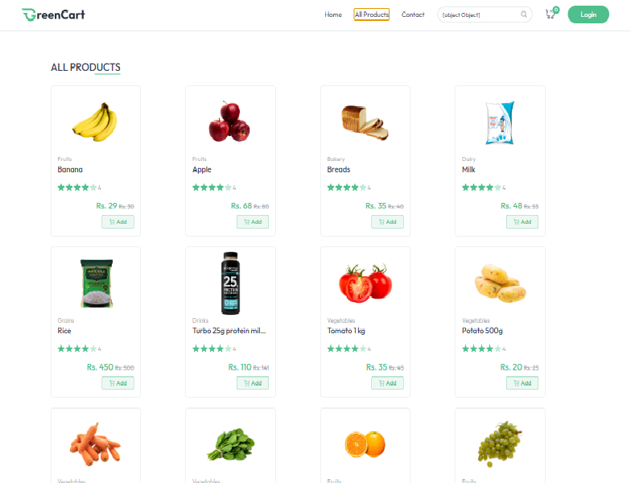
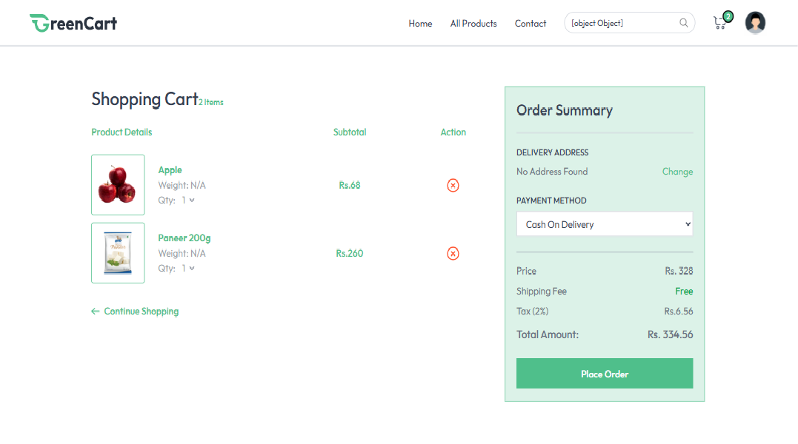

# 🛒 Grocery Delivery Project

A full-stack **Grocery Delivery Web App** that allows users to browse grocery items, add them to a cart, and place orders. Sellers can add products, update stock, and manage inventory.

---

## 📸 Screenshots & Previews

<p align="center">
  
  <br>
  <em>Landing Page</em>
</p>

<p align="center">
  
  <br>
  <em>All Products</em>
</p>

<p align="center">
  
  <br>
  <em>Cart Page & Checkout System</em>
</p>

---

## 📁 Folder Structure

Frontend /frontend

```bash
groceryDeliveryProject/
├──frontend/
 ├── components/
 ├── pages/
 ├── assets/
 ├── App.jsx
 ├── main.jsx
 ├── index.css
```

Backend /backend

```bash
groceryDeliveryProject/
├──backend/
 ├── src/
  ├── controllers/
  ├── routes/
  ├── models/
  ├── middleware/
  ├── configs/
  ├── app.js
 ├── server.js
 ├── .env
```

---

## 🧩 Tech Stack

### 🖥 Frontend:

- React.js
- Tailwind CSS
- React Router
- Axios

### 🛠 Backend:

- Node.js
- Express.js
- MongoDB (Mongoose)
- JWT (Authentication)
- Multer (File uploads)
- Cloudinary (Image storage)

---

## 🌐 Live Demo

Coming soon...

---

## 🚀 Getting Started

### 🔧 Prerequisites

- Node.js
- MongoDB Atlas or local MongoDB
- Cloudinary Account

---

## ⚙️ Backend Setup

### 📍 Navigate to Backend

```bash
cd backend
```

📦 Install Dependencies

```bash
npm install
```

🗝 Create .env File

```bash
PORT=5000
MONGODB_URI=your_mongodb_uri
JWT_SECRET=your_jwt_secret
CLOUDINARY_CLOUD_NAME=your_cloud_name
CLOUDINARY_API_KEY=your_api_key
CLOUDINARY_API_SECRET=your_api_secret
```

▶️ Run Server
Server will run at http://localhost:5000

### 📂 API Route Overview

| **Route Path** | **Description**     | **Handled By**  |
| -------------- | ------------------- | --------------- |
| `/api/user`    | User auth & profile | `userRouter`    |
| `/api/seller`  | Seller operations   | `sellerRouter`  |
| `/api/product` | Product management  | `productRouter` |
| `/api/cart`    | Cart operations     | `cartRouter`    |
| `/api/address` | Address management  | `addressRouter` |
| `/api/order`   | Order processing    | `orderRouter`   |

🌐 API Endpoints (Examples)

Authentication

POST /api/user/register

POST /api/user/login

Seller
POST /api/seller/register

POST /api/seller/login

Products
POST /api/product/add (Protected - Seller)

GET /api/product/list

GET /api/product/productById?id=

Cart & Orders
POST /api/cart/add

GET /api/cart/view

POST /api/order/place

🧑‍🎨 Frontend Setup
📍 Navigate to Frontend
bash
Copy
Edit
cd frontend
📦 Install Dependencies

```bash
Copy
Edit
npm install
```

📁 Environment Variables (Optional)
If using environment variables (e.g., for base API URL), create a .env file:

```bash
VITE_API_URL=http://localhost:5000
```

▶️ Run Frontend

```bash
npm run dev
```

App runs on http://localhost:5173

🖼 Features
👤 User
Register/Login

Browse products

Add to cart

Place orders

View order history

🛒 Seller/Admin
Register/Login

Add new products with images

View all products

Update stock

Manage orders

## 🤖 E2E Testing /e2e-tests

This section contains the automated end-to-end test suite built with **Playwright** and **Node.js** to validate the main buyer, seller, and checkout flows of the Grocery Delivery application.

### 📂 Automation Folder Structure

```text
GroceryDeliveryProject/
└── e2e-tests/
    ├── tests/
    │   ├── auth/
    │   │   ├── seller.setup.js
    │   │   └── user.setup.js
    │   ├── pages/
    │   ├── specs/
    │   │   ├── addProduct.spec.js
    │   │   ├── auth.spec.js
    │   │   ├── cart.spec.js
    │   │   ├── checkout.spec.js
    │   │   ├── invalidLogin.spec.js
    │   │   ├── invalidRegister.spec.js
    │   │   ├── order.spec.js
    │   │   └── searchProduct.spec.js
    │   └── data/
    ├── playwright-report/
    ├── test-results/
    ├── package.json
    └── playwright.config.js
```

### 🔑 Automated Test Scenarios Covered

1. **Seller Authentication Setup**
   - Logs in as seller using stored session state for protected seller flows.

2. **User Authentication Flow (`auth.spec.js`)**
   - Validates user registration and login.
   - Verifies successful navigation after authentication.

3. **Invalid Login & Registration Tests**
   - `invalidLogin.spec.js` checks invalid credentials and unregistered users.
   - `invalidRegister.spec.js` checks duplicate emails, weak passwords, and empty fields.

4. **Product Management**
   - `addProduct.spec.js` validates seller product creation using a sample image upload.

5. **Cart & Search Experience**
   - `cart.spec.js` checks product addition to cart flow.
   - `searchProduct.spec.js` validates product search behavior.

6. **Checkout & Order Flow**
   - `checkout.spec.js` tests address entry and order placement.
   - `order.spec.js` verifies order-related user actions.

### 🛠️ How to Run the Automation Tests Locally

1. **Navigate to the testing directory:**

   ```bash
   cd e2e-tests
   ```

2. **Install testing dependencies:**

   ```bash
   npm install
   ```

3. **Install Playwright browsers:**

   ```bash
   npx playwright install
   ```

4. **Execute all tests in headless mode (default):**

   ```bash
   npx playwright test
   ```

5. **Execute a specific spec:**

   ```bash
   npx playwright test tests/specs/addProduct.spec.js
   ```

6. **Execute tests with visual browser UI (Headed mode):**

   ```bash
   npx playwright test --headed
   ```

7. **View the interactive HTML test execution report:**

   ```bash
   npx playwright show-report
   ```

📤 Deployment Suggestions
Backend
Render

Railway

Vercel Functions (API)

Frontend
Vercel

Netlify

GitHub Pages (for static build)

🤝 Contributing
Pull requests are welcome. For major changes, please open an issue first to discuss what you would like to change.

📄 License
This project is licensed under the MIT License.

